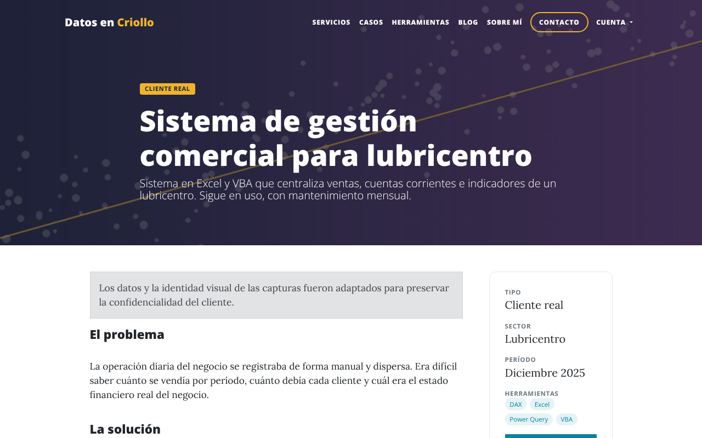
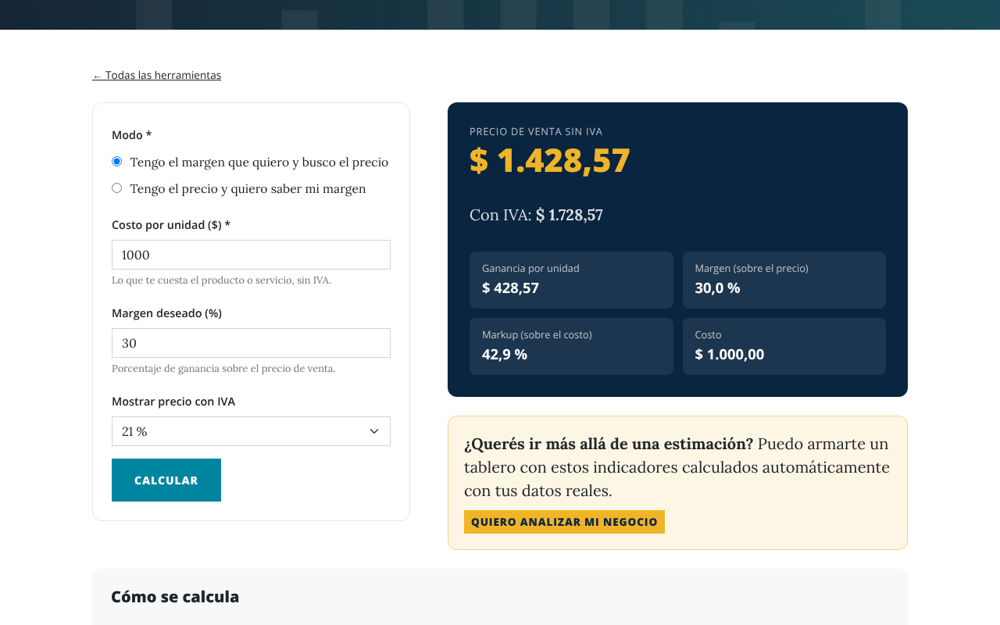
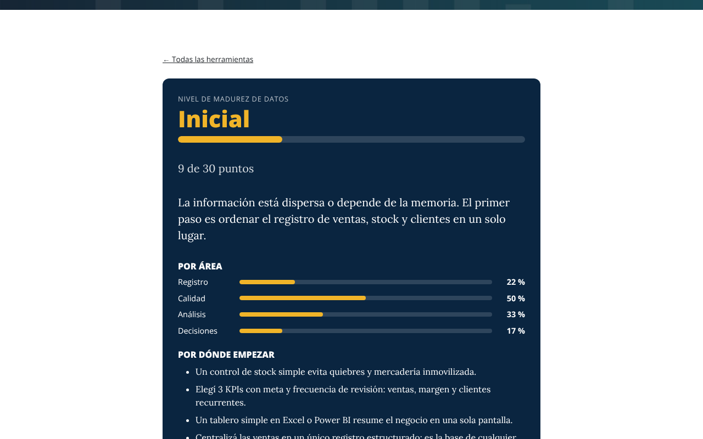
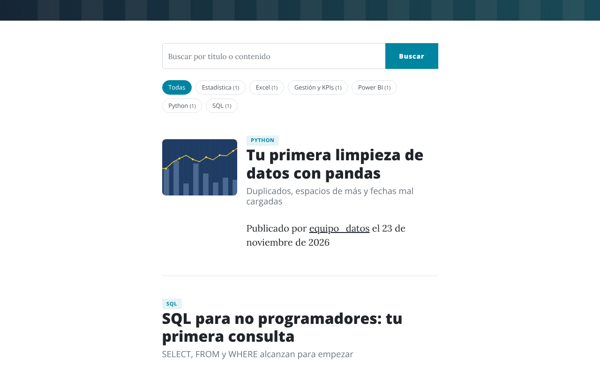

# Datos en Criollo

Sitio profesional de **Damián Emiliano Cordoba**, analista de datos, desarrollado con **Django**.

Nació como blog y trabajo final de la materia Python de la Diplomatura en Ciencia de Datos (versión entregada: etiqueta [`v1.0-entrega`](https://github.com/damian-cordoba/blog-django/tree/v1.0-entrega)). Hoy reúne:

- **Servicios y casos de estudio**: qué problemas resuelvo para PyMEs y cómo los resolví, con el problema, la solución y los resultados de cada proyecto.
- **Herramientas gratuitas para PyMEs**: calculadoras de punto de equilibrio, precio y margen, impacto de descuentos, y un diagnóstico de madurez de datos.
- **Blog de divulgación**: análisis de datos explicado de manera simple. Cualquier persona registrada puede publicar artículos.
- **Contacto**: formulario cuyas consultas quedan guardadas en el panel de administración, con aviso por correo opcional.

## Capturas

**Portada**


**Caso de estudio**



**Calculadora de precio y margen**



**Resultado del diagnóstico de datos**



**Blog con buscador y categorías**



---

## Tecnologías

- **Python 3.11 o superior**
- **Django 5.2** (LTS)
- **SQLite** como base de datos
- **Pillow** para el manejo de imágenes
- **python-decouple** para las variables de entorno
- **HTML, CSS y JavaScript**
- **Bootstrap 5**, mediante la plantilla [Clean Blog](https://startbootstrap.com/theme/clean-blog) de Start Bootstrap (licencia MIT)

## Funcionalidades

**Sitio profesional**
- Portada con propuesta de valor, servicios destacados, casos de estudio, herramientas y últimos artículos.
- Páginas **Sobre mí**, **Servicios** y **Contacto**. Todo el contenido (biografía, foto, redes, WhatsApp, servicios) se edita desde el panel de administración, sin tocar código.
- Formulario de contacto con validación, campo trampa contra bots y aviso por correo opcional. Cada consulta guarda desde dónde llegó (por ejemplo, desde el diagnóstico o un caso de estudio) y tiene un estado (nueva, en curso, respondida, archivada).
- Botón flotante de WhatsApp, que solo aparece si se carga un número en el perfil.

**Casos de estudio**
- Listado con filtros por tipo de proyecto (cliente real, formación, personal) y por herramienta.
- Detalle con problema, solución, resultados y detalle técnico, portada, galería de capturas y enlaces al repositorio.
- Tableros embebidos de Power BI, Looker Studio, Tableau Public o YouTube. Solo se aceptan enlaces `https` de esos sitios.

**Herramientas para PyMEs**
- **Punto de equilibrio**: unidades y facturación necesarias para cubrir los costos fijos, y para alcanzar una ganancia deseada.
- **Precio y margen**: precio según el margen buscado, o margen real a partir del precio; margen vs. markup; precio con IVA.
- **¿Conviene ese descuento?**: cuánto más hay que vender para ganar lo mismo después de una promoción.
- **Diagnóstico de datos**: 10 preguntas, nivel de madurez, resultado por área y recomendaciones. Los resultados se guardan de forma anónima.
- Los cálculos están separados de las vistas (`herramientas/calculos.py`) y usan `Decimal` para evitar errores de redondeo.

**Publicaciones**
- Listado de publicaciones con paginación (6 por página).
- Detalle de cada publicación.
- Crear, editar y eliminar publicaciones desde la interfaz web, sin pasar por el panel de administración.
- Imagen de portada opcional: se guarda en `media/posts/` y los templates funcionan con o sin imagen.
- Al eliminar una publicación o reemplazar su imagen, el archivo anterior se borra del disco.

**Categorías y búsqueda**
- Seis categorías iniciales: Excel, Power BI, SQL, Python, Estadística, Gestión y KPIs. Se cargan automáticamente con `migrate`.
- Filtro de publicaciones por categoría.
- Búsqueda por título, subtítulo o contenido. Muestra la cantidad de resultados, avisa cuando no hay coincidencias y trata las búsquedas vacías.

**Usuarios**
- Registro con formulario propio. Al registrarse, el usuario queda con la sesión iniciada.
- Inicio y cierre de sesión. El cierre se hace por POST, como exige Django 5.
- Perfil creado automáticamente con una señal (`post_save`): avatar, biografía y sitio web.
- Perfil público de cada autor con sus publicaciones, y edición del perfil propio.
- La navegación cambia según el usuario sea anónimo o autenticado.

**Seguridad y permisos**
- Crear, editar y eliminar publicaciones requiere sesión iniciada (`LoginRequiredMixin`). Editar el perfil también (`@login_required`).
- La protección está en las vistas, no solo en los botones. Si un visitante anónimo entra por URL directa, se lo redirige al login.
- Solo el autor de una publicación, o un usuario *staff*, puede editarla o eliminarla. Cualquier otro usuario recibe un error 403.
- La clave secreta y la configuración sensible se leen desde un archivo `.env` que no se sube al repositorio.

---

## Estructura del proyecto

```
blog-django/
├── config/               # Proyecto Django: settings, urls, wsgi/asgi
├── posts/                # App de publicaciones y categorías
│   ├── management/commands/cargar_datos_demo.py   # carga contenido de ejemplo
│   ├── migrations/       # 0002 carga las categorías iniciales
│   ├── templates/posts/  # listado, detalle, formulario, confirmar borrado
│   ├── context_processors.py   # categorías disponibles en todos los templates
│   ├── forms.py, models.py, signals.py, urls.py, views.py
│   └── tests.py
├── usuarios/             # App de registro, login/logout y perfiles
│   ├── templates/usuarios/
│   ├── forms.py, models.py (Profile), signals.py, urls.py, views.py
│   └── tests.py
├── sitio/                # Portada, Sobre mí, Servicios y Contacto
│   ├── management/commands/cargar_contenido_profesional.py
│   ├── templatetags/formato.py   # números en formato argentino y texto con listas
│   ├── models.py (PerfilProfesional, Servicio, Consulta), forms.py, views.py
│   └── tests.py
├── portafolio/           # Casos de estudio (Proyecto, Herramienta, ImagenProyecto)
├── herramientas/         # Calculadoras y diagnóstico
│   ├── calculos.py       # fórmulas, separadas de las vistas
│   ├── diagnostico.py    # preguntas, puntaje y recomendaciones
│   └── tests.py
├── templates/            # base.html, errores 403/404 y parciales
├── static/               # CSS, JS e imágenes de la plantilla
├── media/                # (se crea solo) imágenes subidas por usuarios
├── docs/capturas/        # capturas usadas en este README
├── .env.example          # variables de entorno de ejemplo
├── requirements.txt
└── manage.py
```

### Rutas principales

| URL | Descripción | Requiere sesión |
|---|---|---|
| `/` | Portada | No |
| `/servicios/` · `/sobre-mi/` · `/contacto/` | Páginas profesionales | No |
| `/casos/` · `/casos/<slug>/` | Casos de estudio | No |
| `/herramientas/` | Calculadoras y diagnóstico | No |
| `/blog/` | Listado y búsqueda de artículos (`?q=`) | No |
| `/posts/<slug>/` | Detalle de una publicación | No |
| `/posts/crear/` | Nueva publicación | Sí |
| `/posts/<slug>/editar/` | Editar publicación | Sí (autor) |
| `/posts/<slug>/eliminar/` | Eliminar publicación | Sí (autor) |
| `/blog/categoria/<slug>/` | Publicaciones de una categoría | No |
| `/cuentas/registro/` | Crear cuenta | No |
| `/cuentas/login/` · `/cuentas/logout/` | Iniciar / cerrar sesión | — |
| `/cuentas/perfil/` | Mi perfil | Sí |
| `/cuentas/perfil/editar/` | Editar mi perfil | Sí |
| `/autores/<usuario>/` | Perfil público de un autor | No |
| `/admin/` | Panel de administración | Superusuario |

---

## Requisitos previos

- [Python](https://www.python.org/downloads/) 3.11 o superior. En Windows, marcá la opción **"Add Python to PATH"** al instalarlo.
- [Git](https://git-scm.com/downloads).

## Instalación

### 1. Clonar el repositorio

```bash
git clone https://github.com/damian-cordoba/blog-django.git
cd blog-django
```

### 2. Crear y activar el entorno virtual

**Windows (PowerShell o CMD):**
```bash
python -m venv venv
venv\Scripts\activate
```

> Si PowerShell bloquea la activación, ejecutá una vez:
> `Set-ExecutionPolicy -Scope CurrentUser RemoteSigned`

**Linux / macOS:**
```bash
python3 -m venv venv
source venv/bin/activate
```

### 3. Instalar las dependencias

```bash
pip install -r requirements.txt
```

### 4. Configurar las variables de entorno

Copiá el archivo de ejemplo como `.env`:

**Windows:**
```bash
copy .env.example .env
```

**Linux / macOS:**
```bash
cp .env.example .env
```

Después generá una clave secreta propia y pegala en `SECRET_KEY` dentro de `.env`:

```bash
python -c "from django.core.management.utils import get_random_secret_key; print(get_random_secret_key())"
```

| Variable | Descripción | Valor para desarrollo |
|---|---|---|
| `SECRET_KEY` | Clave secreta de Django | la que generaste |
| `DEBUG` | Modo depuración. Tiene que estar en `True` para ver las imágenes en local | `True` |
| `ALLOWED_HOSTS` | Hosts permitidos, separados por coma | `127.0.0.1,localhost` |
| `EMAIL_HOST`, `EMAIL_PORT`, `EMAIL_HOST_USER`, `EMAIL_HOST_PASSWORD`, `DEFAULT_FROM_EMAIL` | Opcionales: para recibir por correo cada consulta del formulario. Sin ellas, los correos se muestran en la terminal y las consultas igual quedan en el admin. | vacías |

## Base de datos

El repositorio no incluye `db.sqlite3`: la base se crea desde cero con las migraciones.

```bash
python manage.py migrate
```

Esto crea las tablas y carga las seis categorías iniciales.

Para cargar el contenido profesional (perfil, 7 servicios y 8 casos de estudio):

```bash
python manage.py cargar_contenido_profesional
```

**Opcional:** para cargar seis publicaciones de ejemplo en el blog, cuatro con imagen y dos sin imagen:

```bash
python manage.py cargar_datos_demo
```

Los dos comandos se pueden ejecutar más de una vez sin duplicar contenido. `cargar_contenido_profesional` no pisa lo que hayas editado en el admin, salvo que lo ejecutes con `--actualizar`.

> `python manage.py makemigrations` solo hace falta si modificás los modelos. Las migraciones del proyecto ya están incluidas en el repositorio.

## Ejecución

```bash
python manage.py runserver
```

Abrí el sitio en **http://127.0.0.1:8000/** (el blog está en **/blog/**).

## Administrador

Para usar el panel de administración en `/admin/`, creá un superusuario:

```bash
python manage.py createsuperuser
```

El superusuario también puede editar y eliminar publicaciones de cualquier autor desde la interfaz web.

Desde el panel se administra todo el contenido profesional:

| Sección del admin | Para qué sirve |
|---|---|
| **Sitio profesional → Perfil profesional** | Biografía, foto, habilidades, formación, correo, LinkedIn, GitHub y número de WhatsApp. |
| **Sitio profesional → Servicios** | Alta, orden y servicios destacados en la portada. |
| **Sitio profesional → Consultas** | Mensajes del formulario de contacto, con estado y notas internas. |
| **Casos de estudio** | Proyectos, portada, galería de capturas y tablero embebido. |
| **Herramientas para PyMEs → Resultados de diagnóstico** | Resultados anónimos del diagnóstico de datos. |

Para embeber un tablero de Power BI, en Power BI Service usá **Archivo → Insertar informe → Publicar en la web** y pegá el enlace en el campo "Tablero embebido" del caso. Tené en cuenta que esa opción deja el informe visible para cualquier persona: usala solo con datos de demostración.

## Pruebas automatizadas

```bash
python manage.py test
```

Son 81 pruebas:
- **Blog y usuarios:** CRUD de publicaciones, subida y borrado de imágenes, búsqueda, categorías, rutas protegidas, registro, login, logout y perfil.
- **Sitio profesional:** formulario de contacto, envío de avisos por correo, campo trampa contra bots y formato de números.
- **Casos de estudio:** filtros, publicación y validación de tableros embebidos.
- **Herramientas:** fórmulas de las calculadoras y puntaje del diagnóstico.

Las pruebas usan una carpeta temporal, así que no tocan tu carpeta `media/`.

## Archivos multimedia

- `MEDIA_ROOT` apunta a la carpeta `media/` del proyecto y `MEDIA_URL` a `/media/`.
- Las portadas de las publicaciones se guardan en `media/posts/`, los avatares en `media/avatares/`, la foto del perfil profesional en `media/perfil/` y las imágenes de los casos en `media/proyectos/`.
- La carpeta `media/` **no se sube al repositorio**. Se crea sola la primera vez que alguien sube una imagen, o al ejecutar `cargar_datos_demo`.
- En desarrollo (`DEBUG=True`) Django sirve las imágenes automáticamente.
- Si una publicación no tiene imagen, se muestra sin miniatura y con un encabezado genérico. Nada falla.
- Formatos aceptados: JPG, PNG, GIF y WEBP. Máximo 5 MB para portadas y 2 MB para avatares. Pillow valida que el archivo sea realmente una imagen.

## Consideraciones

- El proyecto está configurado para **desarrollo local**. Para publicarlo en un servidor habría que usar `DEBUG=False`, configurar `ALLOWED_HOSTS`, ejecutar `collectstatic` (destino: `staticfiles/`) y servir `media/` desde el servidor web.
- Las tipografías de la plantilla se cargan desde Google Fonts. Sin conexión a internet el sitio funciona igual, con las fuentes del sistema.
- La cuenta de ejemplo `equipo_datos` que crea `cargar_datos_demo` no tiene una contraseña utilizable. Para publicar, registrate con tu propio usuario.
- El contenido de las publicaciones es texto plano: los saltos de línea se respetan, pero no se interpreta HTML ni Markdown.
- En los casos de estudio, servicios y biografía, las líneas que empiezan con `- ` se muestran como listas y las que empiezan con `1. ` como listas numeradas. El texto siempre se escapa, así que no se puede inyectar HTML.
- Las calculadoras dan estimaciones orientativas y no reemplazan el asesoramiento contable.

## Autor

**Damián Emiliano Cordoba**
Analista de datos · Salta, Argentina
[LinkedIn](https://www.linkedin.com/in/damian-emiliano-cordoba/) · [GitHub](https://github.com/damian-cordoba)
