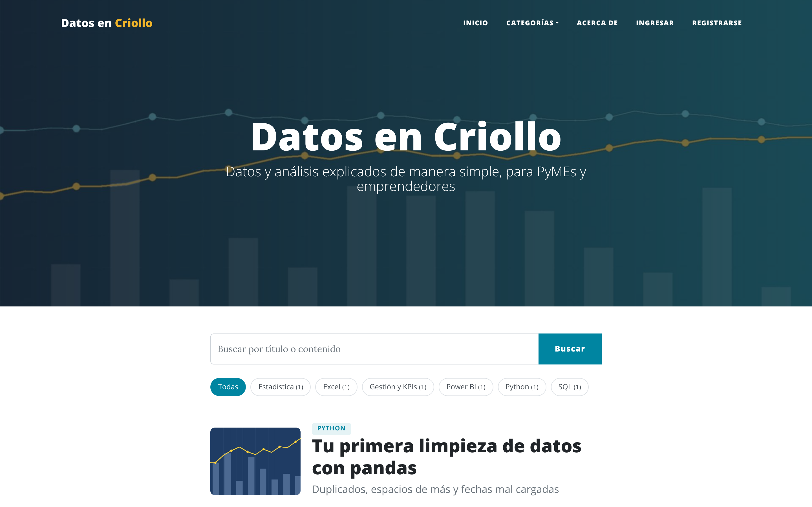
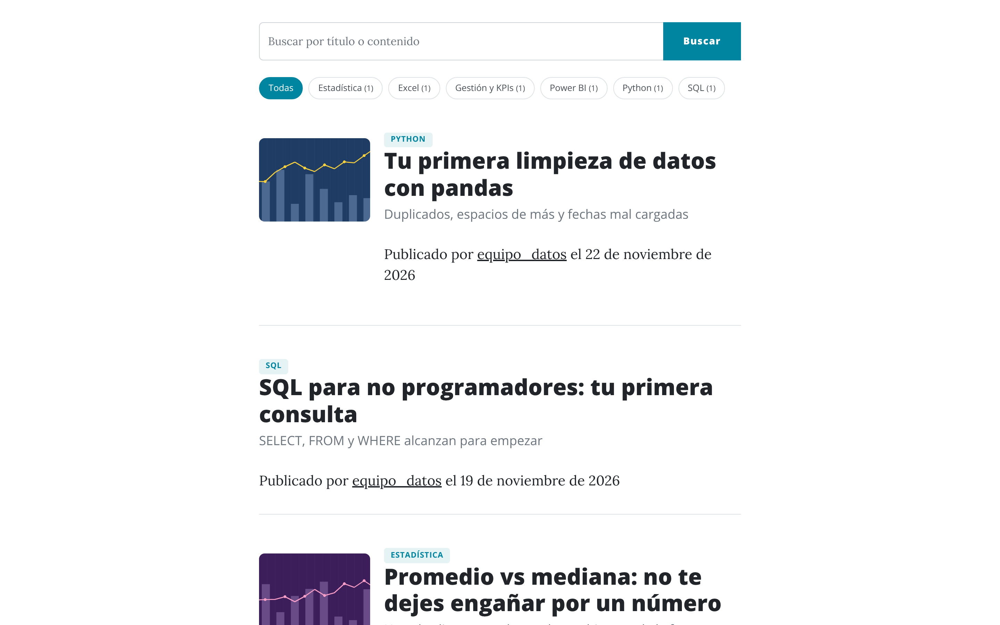
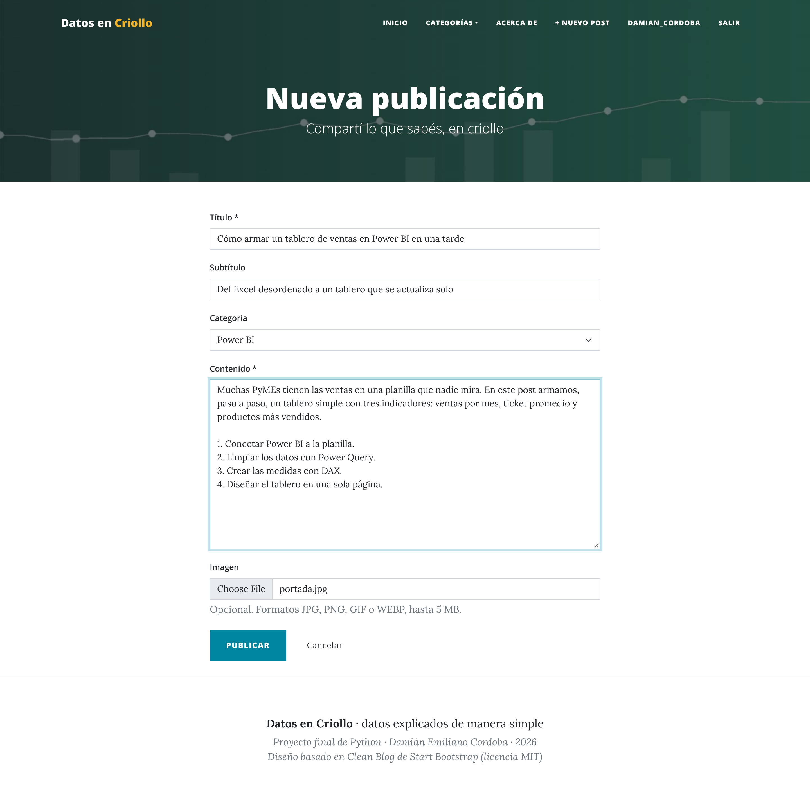

# Datos en Criollo

Blog web desarrollado con **Django** como trabajo final de la materia Python de la Diplomatura en Ciencia de Datos.

**Datos en Criollo** es un blog de divulgación sobre análisis de datos pensado para dueños de PyMEs, emprendedores y profesionales no técnicos. Explica en lenguaje simple temas como KPIs, Excel, Power BI, SQL, Python y estadística básica. Cualquier persona registrada puede publicar artículos, y cada autor tiene un perfil público con sus publicaciones.

## Capturas

**Portada**



**Listado con buscador y categorías**



**Formulario de nueva publicación**



---

## Tecnologías

- **Python 3.11 o superior**
- **Django 5.2** (LTS)
- **SQLite** como base de datos
- **Pillow** para el manejo de imágenes
- **python-decouple** para las variables de entorno
- **HTML, CSS y JavaScript**
- **Bootstrap 5**, mediante la plantilla [Clean Blog](https://startbootstrap.com/theme/clean-blog) de Start Bootstrap (licencia MIT)

## Funcionalidades

**Publicaciones**
- Listado de publicaciones con paginación (6 por página).
- Detalle de cada publicación.
- Crear, editar y eliminar publicaciones desde la interfaz web, sin pasar por el panel de administración.
- Imagen de portada opcional: se guarda en `media/posts/` y los templates funcionan con o sin imagen.
- Al eliminar una publicación o reemplazar su imagen, el archivo anterior se borra del disco.

**Categorías y búsqueda**
- Seis categorías iniciales: Excel, Power BI, SQL, Python, Estadística, Gestión y KPIs. Se cargan automáticamente con `migrate`.
- Filtro de publicaciones por categoría.
- Búsqueda por título, subtítulo o contenido. Muestra la cantidad de resultados, avisa cuando no hay coincidencias y trata las búsquedas vacías.

**Usuarios**
- Registro con formulario propio. Al registrarse, el usuario queda con la sesión iniciada.
- Inicio y cierre de sesión. El cierre se hace por POST, como exige Django 5.
- Perfil creado automáticamente con una señal (`post_save`): avatar, biografía y sitio web.
- Perfil público de cada autor con sus publicaciones, y edición del perfil propio.
- La navegación cambia según el usuario sea anónimo o autenticado.

**Seguridad y permisos**
- Crear, editar y eliminar publicaciones requiere sesión iniciada (`LoginRequiredMixin`). Editar el perfil también (`@login_required`).
- La protección está en las vistas, no solo en los botones. Si un visitante anónimo entra por URL directa, se lo redirige al login.
- Solo el autor de una publicación, o un usuario *staff*, puede editarla o eliminarla. Cualquier otro usuario recibe un error 403.
- La clave secreta y la configuración sensible se leen desde un archivo `.env` que no se sube al repositorio.

---

## Estructura del proyecto

```
blog-django/
├── config/               # Proyecto Django: settings, urls, wsgi/asgi
├── posts/                # App de publicaciones y categorías
│   ├── management/commands/cargar_datos_demo.py   # carga contenido de ejemplo
│   ├── migrations/       # 0002 carga las categorías iniciales
│   ├── templates/posts/  # listado, detalle, formulario, confirmar borrado
│   ├── context_processors.py   # categorías disponibles en todos los templates
│   ├── forms.py, models.py, signals.py, urls.py, views.py
│   └── tests.py
├── usuarios/             # App de registro, login/logout y perfiles
│   ├── templates/usuarios/
│   ├── forms.py, models.py (Profile), signals.py, urls.py, views.py
│   └── tests.py
├── templates/            # base.html, acerca, errores 403/404 y parciales
├── static/               # CSS, JS e imágenes de la plantilla
├── media/                # (se crea solo) imágenes subidas por usuarios
├── docs/capturas/        # capturas usadas en este README
├── .env.example          # variables de entorno de ejemplo
├── requirements.txt
└── manage.py
```

### Rutas principales

| URL | Descripción | Requiere sesión |
|---|---|---|
| `/` | Listado y búsqueda (`?q=`) | No |
| `/posts/<slug>/` | Detalle de una publicación | No |
| `/posts/crear/` | Nueva publicación | Sí |
| `/posts/<slug>/editar/` | Editar publicación | Sí (autor) |
| `/posts/<slug>/eliminar/` | Eliminar publicación | Sí (autor) |
| `/categoria/<slug>/` | Publicaciones de una categoría | No |
| `/acerca/` | Acerca del blog | No |
| `/cuentas/registro/` | Crear cuenta | No |
| `/cuentas/login/` · `/cuentas/logout/` | Iniciar / cerrar sesión | — |
| `/cuentas/perfil/` | Mi perfil | Sí |
| `/cuentas/perfil/editar/` | Editar mi perfil | Sí |
| `/autores/<usuario>/` | Perfil público de un autor | No |
| `/admin/` | Panel de administración | Superusuario |

---

## Requisitos previos

- [Python](https://www.python.org/downloads/) 3.11 o superior. En Windows, marcá la opción **"Add Python to PATH"** al instalarlo.
- [Git](https://git-scm.com/downloads).

## Instalación

### 1. Clonar el repositorio

```bash
git clone https://github.com/damian-cordoba/blog-django.git
cd blog-django
```

### 2. Crear y activar el entorno virtual

**Windows (PowerShell o CMD):**
```bash
python -m venv venv
venv\Scripts\activate
```

> Si PowerShell bloquea la activación, ejecutá una vez:
> `Set-ExecutionPolicy -Scope CurrentUser RemoteSigned`

**Linux / macOS:**
```bash
python3 -m venv venv
source venv/bin/activate
```

### 3. Instalar las dependencias

```bash
pip install -r requirements.txt
```

### 4. Configurar las variables de entorno

Copiá el archivo de ejemplo como `.env`:

**Windows:**
```bash
copy .env.example .env
```

**Linux / macOS:**
```bash
cp .env.example .env
```

Después generá una clave secreta propia y pegala en `SECRET_KEY` dentro de `.env`:

```bash
python -c "from django.core.management.utils import get_random_secret_key; print(get_random_secret_key())"
```

| Variable | Descripción | Valor para desarrollo |
|---|---|---|
| `SECRET_KEY` | Clave secreta de Django | la que generaste |
| `DEBUG` | Modo depuración. Tiene que estar en `True` para ver las imágenes en local | `True` |
| `ALLOWED_HOSTS` | Hosts permitidos, separados por coma | `127.0.0.1,localhost` |

## Base de datos

El repositorio no incluye `db.sqlite3`: la base se crea desde cero con las migraciones.

```bash
python manage.py migrate
```

Esto crea las tablas y carga las seis categorías iniciales.

**Opcional:** para cargar seis publicaciones de ejemplo, cuatro con imagen y dos sin imagen:

```bash
python manage.py cargar_datos_demo
```

El comando se puede ejecutar más de una vez sin duplicar contenido.

> `python manage.py makemigrations` solo hace falta si modificás los modelos. Las migraciones del proyecto ya están incluidas en el repositorio.

## Ejecución

```bash
python manage.py runserver
```

Abrí el blog en **http://127.0.0.1:8000/**

## Administrador

Para usar el panel de administración en `/admin/`, creá un superusuario:

```bash
python manage.py createsuperuser
```

El superusuario también puede editar y eliminar publicaciones de cualquier autor desde la interfaz web.

## Pruebas automatizadas

```bash
python manage.py test
```

Son 33 pruebas que cubren el CRUD de publicaciones, la subida y el borrado de imágenes, la búsqueda, el filtro por categoría, el acceso de visitantes anónimos y de otros usuarios a las rutas protegidas, el registro, el login, el logout y la edición del perfil. Las pruebas usan una carpeta temporal, así que no tocan tu carpeta `media/`.

## Archivos multimedia

- `MEDIA_ROOT` apunta a la carpeta `media/` del proyecto y `MEDIA_URL` a `/media/`.
- Las portadas de las publicaciones se guardan en `media/posts/` y los avatares en `media/avatares/`.
- La carpeta `media/` **no se sube al repositorio**. Se crea sola la primera vez que alguien sube una imagen, o al ejecutar `cargar_datos_demo`.
- En desarrollo (`DEBUG=True`) Django sirve las imágenes automáticamente.
- Si una publicación no tiene imagen, se muestra sin miniatura y con un encabezado genérico. Nada falla.
- Formatos aceptados: JPG, PNG, GIF y WEBP. Máximo 5 MB para portadas y 2 MB para avatares. Pillow valida que el archivo sea realmente una imagen.

## Consideraciones

- El proyecto está configurado para **desarrollo local**. Para publicarlo en un servidor habría que usar `DEBUG=False`, configurar `ALLOWED_HOSTS`, ejecutar `collectstatic` (destino: `staticfiles/`) y servir `media/` desde el servidor web.
- Las tipografías de la plantilla se cargan desde Google Fonts. Sin conexión a internet el sitio funciona igual, con las fuentes del sistema.
- La cuenta de ejemplo `equipo_datos` que crea `cargar_datos_demo` no tiene una contraseña utilizable. Para publicar, registrate con tu propio usuario.
- El contenido de las publicaciones es texto plano: los saltos de línea se respetan, pero no se interpreta HTML ni Markdown.

## Autor

**Damián Emiliano Cordoba**
Analista de datos · Salta, Argentina
Trabajo final de la materia Python de la Diplomatura en Ciencia de Datos.
